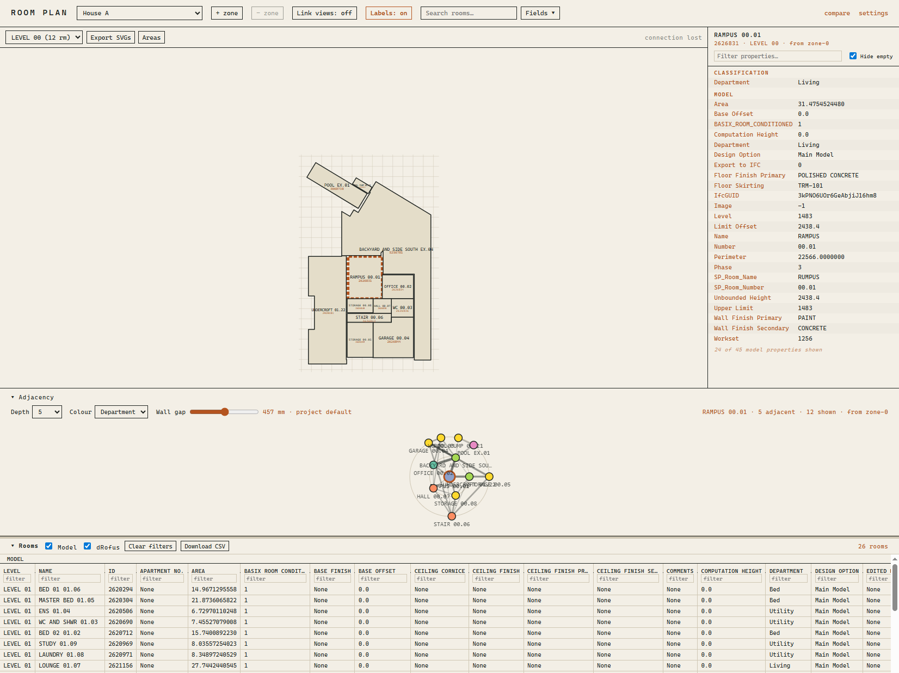

# RoomMate

Revit model data → a Rust server → a browser floor-plan viewer. **Seven
entities** — rooms, doors, windows, ceilings, floors, FF&E and spaces — are
extracted from Revit, pushed as a versioned JSON contract, joined against
external reference data (dRofus is the common one; the pipeline is keyed on N
sources), classified into a project's own hierarchy, and served to a viewer that
draws plans, aggregates areas, reconciles each entity against the model,
graphs which rooms share a wall and finds the shortest route between two rooms
— plus a reports page that tabulates any of it.

It also sends work **back** to Revit. A room layout is stored as a *blueprint*
(a recipe against the room's walls), assigned to other rooms, and turned into
*tasks* that a Revit session claims: place the items, or **create a room layout
sheet** (the plan, elevations, a 3D view and a schedule, numbered and named from
the model's own settings). Creating a room layout sheet has run in Revit end to
end; see [Revit-side status](#revit-side-status).



**Start with [docs/](docs) — [Architecture & Strategy](docs/STRATEGY.md) is the
index.** The design rationale lives there, not here; this file is orientation
only.

## Layout

The top level maps to the pipeline, so where a thing lives tells you which stage
it belongs to:

| | |
|---|---|
| [`extractor/`](extractor) | The **producer and the Revit-side worker**. `pyRevit/` holds the IronPython that runs inside Revit: it pushes to the server and claims its tasks (`RoomMate.extension` is the `RoomMate` panel; `room_m` is the code). `tests/` runs its pure parts on CPython. `duhast.lock` pins the duHast it ships with. |
| [`src/`](src) | The **Rust server** — ingest, storage, the reference join, classification, the geometry services (`areas`, `adjacency`, `room_locator`), and the authored data (blueprints, assignments, tasks, the sheet library, tag rules). Two binaries: the axum HTTP server and an MCP server over the same read logic. |
| [`crates/`](crates) | Workspace members: `roommate-shared` (the settings types, shared with the frontend through generated TypeScript) and `drofus-mcp`, a **standalone** MCP server over the dRofus Project API (it depends on nothing else here and could be copied out as its own repository). |
| [`static/`](static) | What the server serves: **generated and committed** builds — the viewer (`index.html`, `viewer.js`, `viewer.css`), `vendor/renderer.bundle.js`, and the pages `settings/`, `reports/`, `blueprints/`, `library/` and `tasks/` — so a fresh clone runs with no node installed. Nothing here is hand-written any more except `common.js` and `tokens.css`; edit `src-js/` and rebuild. |
| [`src-js/`](src-js) | The frontend source, built by Vite: the **viewer** (`viewer/`), its **WebGL plan renderer** (`renderer/`), and the pages **settings**, **reports**, **blueprints**, **library** (room layout sheets and tag rules) and **tasks**, all React where they are not the renderer. Where new frontend code lands; see [Coding Conventions](docs/CODING-CONVENTIONS.md). |
| [`samples/house-a/`](samples/house-a) | **A sample project to run the server against**: a small house as Revit pushed it, with a blueprint and its assignment. Built by `scripts/make_sample.py` and read by a test, so it stays in the current format. |
| [`settings/`](settings) | Server config, and one TOML per project (classification tiers, sources, area policy). Every available setting, with a sample of each, is in the [settings reference](docs/SETTINGS.md). |
| [`scripts/`](scripts) | Dev tooling run *against* this repo: fixture generators, `fixtures/` (sample data to push or upload), `check_areas.py` (the areas diagnostic), `weekly_review.py` (the docs-vs-code drift check), `module_stats.py` (measures the module plan's cells; `--check` reports drift), and the `probe_*`/`analyse_*` pairs that settle an entity's open questions before it is built. Not shipped. |
| [`docs/`](docs) | Strategy docs, coding conventions, and handovers (landed ones in `docs/Superseded/`). |
| [`installer/`](installer) | The **Windows package** — an Inno Setup script and the launcher the Start Menu shortcut runs, producing one `RoomMate-Setup.exe` with no prerequisites. See [installer/README.md](installer/README.md). |

## The extractor and the server move together

`extractor/` and `src/` share one versioned wire contract, and the rule is
stated there: **update the extractor and the server together — there is no
transition window.** A producer on the wrong version is rejected loudly rather
than silently misparsed. Each entity carries its own version, all under
[`src/contract/`](src/contract): rooms are at `SUPPORTED_SCHEMA` (v7), and doors,
windows, ceilings, floors, FF&E and spaces each have their own constant beside
it.

That is the reason the extractor lives in this repo rather than beside the other
Revit tooling: a contract change becomes one commit instead of two repos
drifting. The cost of *not* having it here is on record — `room_boundary` was
added to the upload envelope, and the server accepted, resolved and echoed it,
while nothing sent it: for as long as the two halves sat apart, every model fell
back to a *guessed* boundary regime. Closing that was a handful of lines on the
producer once both halves were in one place. See
[Area calculation](docs/STRATEGY-AREA-CALCULATION.md).

Two constraints follow from where the extractor runs:

- **IronPython 2.7, inside Revit** — not CPython 3. Modern syntax and most
  linters do not apply, which is also why it does not live in `scripts/`.
- **CI covers only what can run without Revit.** `.github/workflows/extractor.yml`
  checks that the extension bundles (no non-ASCII byte, every entry point exists), runs
  the pure parts on CPython (`extractor/tests`: the task planner, the RLS planner, the
  settings forms, the geometry) and checks the duHast pin. Anything that calls
  Revit is verified by running it against a real model.
- **Its pyRevit buttons live in this repository**
  (`extractor/pyRevit/RoomMate.extension`, the `RoomMate` panel on the duHast tab) and the installer ships them.
  A checkout is not loadable as it stands: `installer\build-extension.ps1 -Deploy`
  assembles an extension (`room_m` plus a pinned duHast, or a local one with `-DuHastPath`) into
  `%APPDATA%\pyRevit\Extensions`. The Tasks button, which makes room layout sheets
  from the server's tasks, has run in Revit end to end (2026-11-01); see [`CLAUDE.md`](CLAUDE.md) for what has and has not.

## Revit-side status

The `RoomMate` panel (on the duHast tab) has six buttons: **Export** (one window: what to
push, the project, the phase, whole model or chosen levels), **Blueprint**, **Sheets**,
**Tasks**, **RLS settings** and **Server**. The extension is built with
`installer\build-extension.ps1 -Deploy` (`-DuHastPath` uses a local duHast instead of the pinned one).

| | State |
|---|---|
| Pushing the seven entities | Built and in daily use. |
| **Tasks → room layout sheets** | **Run in Revit end to end** (2026-11-01 onwards). A window lists the open model's queued tasks (filter by room, kind and level); the ticked ones are claimed, checked as a whole before anything is made, and each sheet is built in one transaction group: the plan view, the elevations (each marker and its views placed from the template, the elevation line moved by its view pointer, cropped to the room's floor and the template's height), a 3D view with a section box at the template's height, the schedule, viewport types, titles and detail numbers, the annotation crop, and the room tag. Everything it needs is set in **RLS settings** (stored in the model). |
| Tasks → placing items | Built; **not run in Revit**. |
| Tags on items, FF&E tags in elevations | Prototype. Elevations tag nothing by rule yet. |

What each Revit-side rule rests on (including the measured facts about elevation markers and
`Level.Elevation`) is in [`CLAUDE.md`](CLAUDE.md); the design is in
[the blueprints plan](docs/PLAN-blueprints.md).

## Running it

```bash
cargo run -- --server-settings settings/server.toml --project-settings settings/projects
```

To try it on the sample (copy `samples/house-a` first if you will write to it):

```bash
cargo run -- --server-settings samples/house-a/server.toml --project-settings samples/house-a/projects
```

Serves the pages and the API on `http://127.0.0.1:5151` (`--port`, or `$PORT`, moves
it). The host is loopback unless you opt out: `--bind 0.0.0.0` (or `ROOMMATE_BIND`)
serves a closed network, for a Revit session on another computer, and the server has
**no authentication**, so that is for a network you trust. Run it from the repository
root, because it serves `./static`. [Server](docs/STRATEGY-SERVER.md) covers the
endpoints, [Browser](docs/STRATEGY-BROWSER.md) the viewer.

## The pages

| | |
|---|---|
| **`/`** — the viewer | The plan: rooms drawn per storey with the door, window, FF&E, space and ceiling/floor layers over them, the hierarchy-area rollups, the adjacency graph, and the QA band that says whether the project reconciles. Each zone chooses what it draws and what a click can reach; a click on stacked elements lists them rather than guessing; every one of the seven kinds has a panel, and a grid row selects its room and brings it into view. It is also where routes are found and connections are drawn: see [Routes and connections](#routes-and-connections). |
| **`/settings/`** — settings | Every project setting, including the ones that only ever existed in TOML: the coordinate anchor, the area policy, the door/window/FF&E/space policies, the hierarchy exclusions. It holds the settings object as it read it and sends it back, so it cannot silently drop what it does not show — the bug its hand-written predecessor shipped. |
| **`/blueprints/`** — blueprints | A room's layout kept as recipes against its walls: edit it (the reference outline, per-item distances fixed or as a percentage), keep revisions, import and export, and **assign** it to other rooms with the resolver's answer drawn. The blueprint comes only from Revit (the Blueprint button). |
| **`/library/`** — room layout sheets | The sheets pushed from Revit, each with its paper size, preview (viewports, elevation lines and markers, schedule row count), rooms covered and the blueprint it is bound to; accept or reject a renumbered push; the learned **tag rules** for placing tags. |
| **`/tasks/`** — room tasks | What was asked of Revit and what happened: filter by state, read a task's items, sheets, findings and attempts, dismiss, resend, and make populate and update tasks. The main viewer's **RLS tool** queues the room layout sheet tasks. |
| **`/reports/`** — reports | Tabular reports: a **schedule** of any entity, any entity **by room**, the **QA checks** (reference data, unresolved openings, unmatched spaces and rooms), and **milestone comparison**, which used to be its own page. Rows and CSV are rendered by the server, so a download and an MCP host get the same bytes. |

## Routes and connections

The viewer can find the shortest route between two rooms, and lets people state
the connections the model does not hold. All of it is in each zone's toolbar
(**Route**, **Connections**) and behind the endpoints above; the reasoning,
measurements and open questions are in [the plan](docs/PLAN-connectivity.md).

- **Routes.** Pick a start and an end room anywhere (the plan, the grid, a search
  chip). The route runs door to door by the exact shortest walk inside each room,
  or room centre to room centre. It can start and end at a point inside each room,
  and the start and end marks can be **dragged**. A **steps** list reads the whole
  route in order and marks where it changes level.
- **Width and height.** Give the size of the object (a bed, a trolley) and a door or
  open wall narrower than that, a door lower than it, or a **room** lower than it, is
  not a way through. The answer says the narrowest and lowest points and the largest
  object that fits. The route is drawn as wide as the object, so a corridor too narrow
  for it is visible. Door sizes are **estimates**; a room's height comes from the
  ceilings over it, else a room property, and where each is read from is named per
  project under **Routing** in the settings ([reference](docs/SETTINGS.md)); the width of a corridor *inside* a room is not
  checked.
- **Open areas.** Rooms the model does not join by a door (bays, open-plan areas)
  can be declared one open space. Where members touch but do not connect, such as
  bays along a corridor, **Cut** closes a wall between two of them and **Only
  through…** makes the others connect only through one room.
- **Vertical links.** A lift or stair is a run of floor-to-floor links drawn by
  hand. The **stack view** shows only the levels that hold a room of the stack and
  suggests the next room above and below by plan overlap, for a person to confirm.
- **Saved routes.** Name a route, give it a colour and keep it for the whole
  project. Several can be shown at once, in their colours, and they appear in
  **Export SVGs** on every level they pass through, with a legend.
- **The tables.** While a connections editor or a route tool is open, the open
  areas, vertical links and saved routes are listed on the left of the plan, each
  with its levels and a delete.
- **Reach.** The **Reach** tool answers "what can be walked to from here": click one
  or more start rooms, set a walk length and a grid, and the plan shows a heat map of
  the walking distance from the nearest start (a hose reel's coverage, an exit's travel
  distance). It uses the same graph as the routes, so a cell's distance agrees with a
  route's length; **ignore cuts** drops the walls inside open areas. It is per zone, so
  two zones can compare two reaches.
- **Saved reaches.** Name a reach and keep it for the project beside the saved routes;
  they are listed on the left, and **Show** loads one into the focused zone. What is
  saved is the request, so a reach follows the model when it changes.
- **Tags.** Two toggles in the **Layers** menu, both off by default: **Route tags** show
  each hop's length and, in brackets, the walk from the start; **Reach tags** show the
  distance to the start in each grid cell. The heat map, the legend and any switched-on
  tags are included in **Export SVGs**.
- **Element tags.** Under FF&E, Spaces, Ceilings and Floors in the **Layers** menu, a
  **Tags** checkbox (off by default) writes text on each element, sized to fit its own
  outline like the room labels. What it says and its colours are set per entity in the
  settings page's **Element tags** section (`$id`, `$name`, `$type_name` or any property
  name). Included in **Export SVGs**.

## The API, in one screen

Reads, all GET unless noted:

| | |
|---|---|
| `/rooms` | Every model's rooms merged, with their joined reference data and classification. The viewer's main read. |
| `/doors`, `/windows` | Openings, each with the room the project's attribution policy gives it. |
| `/ceilings`, `/floors` | Surfaces, each with the rooms it lies over — geometric, derived per read, stored nowhere. |
| `/ffe` | Items, each with the room it sits in. |
| `/spaces` | Services spaces, per model. |
| `/projects`, `/projects/{id}/buildings`, `/projects/{id}/snapshots`, `/projects/{id}/milestones` | What exists. |
| `/projects/{id}/validation` | The QA reconciliation: rooms against reference data, openings and items against rooms, spaces against rooms, and whether the models agree on a phase. |
| `/projects/{id}/areas`, `/projects/{id}/adjacency` | Hierarchy-area rollups, and which rooms share a wall. |
| `/projects/{id}/connections` | What people have authored: **open areas** (with the walls they keep closed), **vertical links** and **saved routes** and **saved reaches**. GET reads, PUT replaces the whole document and names the version it read (409 if it moved). A save that leaves out `routes` or `reaches` keeps the saved ones. See [the plan](docs/PLAN-connectivity.md). |
| `/projects/{id}/connectivity` | Which rooms a door joins, the rooms no door reaches, and (with `from` and `to`) the shortest route between two rooms, by a chosen `method` (door to door by default; the answer lists them with their sources), optionally from and to a point inside each room (`from_x`/`from_y`, `to_x`/`to_y`), and optionally for an object of a given `width_mm` and `height_mm`: the answer's `clearance` says the narrowest and lowest points, what could not be checked and the largest object that fits. Doors, the open areas people drew and the vertical links they drew; see [the plan](docs/PLAN-connectivity.md). |
| `POST /projects/{id}/reach` | A walking-distance grid per storey from one or more start rooms (`sources`), out to `limit_mm` on a `spacing_mm` grid, by the `exact` (default) or `grid` method; `ignore_cuts` treats open areas' walls as open. Each cell is whole mm, `-1` for no room or `-2` for beyond the limit. The same graph as the routes. MCP tool `get_reach`. |
| `/projects/{id}/stack` | For one room, the rooms over and under it, ranked, as candidates for a vertical link. A suggestion only; nothing is stored. |
| `/projects/{id}/reports/columns` | What a report over one entity may name: the property names this project's snapshots carry with Revit's own value type, the record's `$intrinsics`, joined reference labels, and the join's measures. Read from each snapshot's property dictionary — a tail read, not a parse. |
| `/projects/{id}/reports` (**POST**) | Build one report — a schedule or a by-room table — projected to the columns asked for. `?format=csv` renders the same rows as CSV. A POST that reads, because the definition does not fit a query string. |
| `/projects/{id}/comparison` (**POST**) | Diff a baseline milestone against others. Same shape, same reason. |
| `/api/reports/projects/{project}[/{report}]` | Saved reports: list, read, save (PUT) and delete. One JSON document per report beside the project settings — a saved report is a question somebody kept, not a policy, so it is kept apart from the settings a policy lives in. |
| `/projects/{id}/blueprints[/{blueprint}]`, `/projects/{id}/assignments` | Authored room layouts and where they are assigned. A blueprint's revisions are append-only; a push from Revit waits as a **pending** revision until a person accepts it. Resolving a blueprint against another room (`.../resolve`, `.../solve` for many) answers placements and findings and stores nothing: an assignment is a request, never a result. |
| `/projects/{id}/sheets`, `/projects/{id}/tagrules` | The room layout sheet library (kept by sheet identity, one file per sheet, bound to at most one blueprint) and the tag rules learned from tags in Revit views. `.../sheets/{sheet}/elevations` says which wall each elevation looks at; `.../sheets/suggest` offers sheets for a room and never applies one. |
| `/projects/{id}/tasks`, `POST /projects/{id}/roomtasks` | Room tasks, as records (`GET` lists, one is read in full, dismiss and resend). A Revit session **claims** a model's queued tasks with `POST .../roomtasks` (optionally only some `task_ids`, which is what the Tasks window sends) and reports each with `.../roomtasks/report`. `POST .../tasks/rls-preview` shows what a room layout sheet task would say, and stores nothing. |
| `/api/settings/projects[/{id}]` | Read and save project settings (PUT), which hot-swaps the running registry. |

Writes are the ingest routes the extractor pushes to (`/rooms`, `/doors`,
`/windows`, `/ceilings`, `/floors`, `/ffe`, `/spaces`, each with a `/stream`
sibling) and `/projects/{id}/reference/{source}` for a reference CSV. Every read
route above has a matching **MCP tool** in the second binary — see
[MCP](docs/STRATEGY-MCP.md) and [docs/mcp-host-setup.md](docs/mcp-host-setup.md).

`static/` is found **beside the executable**, falling back to the working
directory — which is what the line above relies on. See `main.rs`'s
`viewer_root` before moving either.

## Installing it

For a machine that is not a development one, [`installer/`](installer) builds a
single `RoomMate-Setup-<version>.exe`: the server, the MCP servers (`mcp.exe` and `drofus-mcp.exe`), the viewer, and a seeded
per-user data folder, with no Rust, node or runtime to install first.

```powershell
winget install JRSoftware.InnoSetup   # build machine only, once
.\installer\build.ps1
```

It installs per-user (no admin), keeps the app under
`%LOCALAPPDATA%\Programs\RoomMate` and everything writable — settings and the
snapshot store — under `%LOCALAPPDATA%\RoomMate`, so an upgrade never touches
an edited project file. [installer/README.md](installer/README.md) has the
reasoning.
