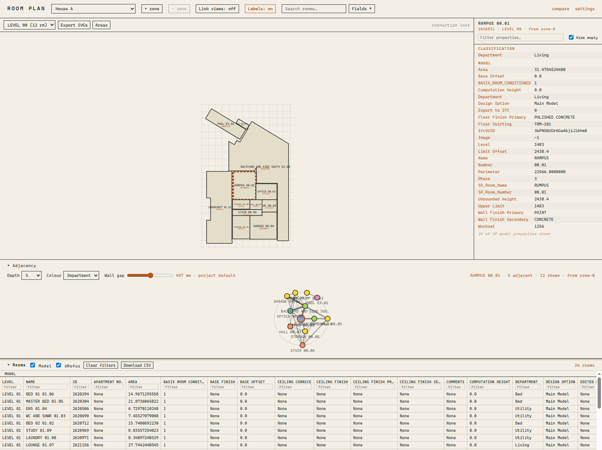

# RoomMate

A web-based 2D data repository built around **rooms**. Revit pushes rooms, doors,
windows, ceilings, floors, FF&E and spaces to a server; the server joins them to
reference data (dRofus is the usual one), checks them against each other, and
serves them to a browser where people explore, analyse and annotate the plan. Work
then flows **back**: room layouts stored once can be applied to other rooms and
sent to Revit as tasks.



Four parts:

| | |
|---|---|
| [1. The viewer](#1-the-viewer) | The browser pages. What most people use. |
| [2. The Revit plugins](#2-the-revit-plugins) | Buttons in Revit that push data and carry out tasks. |
| [3. The MCP servers](#3-the-mcp-servers) | Let an AI assistant read RoomMate and dRofus. |
| [4. The server](#4-the-server) | Rust: ingest, storage, joins, geometry, the API. |

Design rationale lives in [`docs/`](docs) ([Architecture & Strategy](docs/STRATEGY.md) is
the index); this page is orientation only.

## 1. The viewer

Served by the server at `http://127.0.0.1:5151`. Six pages.

### `/` — the plan viewer

**Highlights**

- **Several view panes at once.** Each *zone* is its own plan, with its own storey,
  layers and colours. Put two storeys, or two buildings, side by side.
- **Turns what you see into work for Revit.** The **RLS tool** picks a library sheet
  and the rooms to make it for; the **Blueprint tool** lays a stored room layout over a
  room and assigns it. Both queue tasks that a Revit session picks up.

**Also**

- Layers for all seven entities, each with a panel; colour plans, hover, room labels
  and element tags; a click on stacked elements lists them.
- A QA band that says whether the project reconciles, hierarchy-area rollups and the
  adjacency (shared wall) graph.
- Routes between rooms (with object width and height), open areas, vertical links,
  passages and **reach** (a walking-distance heat map): [details](docs/ROUTES-AND-CONNECTIONS.md).
- Search, a data grid that frames its room, and **Export SVGs** of any level with the zone's layers.

### `/reports/` — reports

**Highlights**

- **Schedules and by-room tables** of any entity, with any property as a column, a
  filter builder, saved reports, and CSV that is byte-identical to what an MCP host gets.
- **QA checks and milestone comparison**: unresolved reference data, openings and
  items that name no room, unmatched spaces; and a diff of a baseline issue against others.

### `/blueprints/` — blueprints

A room's layout (its FF&E and its sheets) stored by room, so it can be applied to
other rooms.

**Highlights**

- **A layout is a recipe, not coordinates.** Each item is a distance along a wall,
  fixed or as a percentage, so it adapts to a room of another size. Reshape the
  reference outline and no item moves.
- **Assign to rooms**, one or many, with the resolver's answer drawn (placements,
  doors compared, findings) before anything is committed. Nudge or leave out single items.

**Also**

- Append-only revisions; a push from Revit waits as *pending* until you accept it.
- Import and export between projects. A blueprint is marked not in use, never deleted.
- Created only from Revit (the Blueprint button).

### `/library/` — room layout sheets

Review the sheet data pushed from Revit.

**Highlights**

- **Every sheet at a glance**: paper size, a drawn preview (viewports, elevation lines,
  markers, schedule rows, and each 3D view's camera as an arrow on the plan), rooms
  covered, and the blueprint it is bound to.
- **Renumbered pushes wait for you**: accept or reject.

**Also**

- The learned **tag rules** (where a tag sits relative to an item), browsable and deletable.
- Suggested sheets for a room, by area, proportions and item count.

### `/tasks/` — room tasks

**Highlights**

- **What was asked of Revit, and what happened**: state, items, sheets, findings and
  every attempt of each task.
- **Make tasks**: populate or update a room from an assignment; dismiss or resend.

**Also**

- Refreshes by itself while a Revit session works. The main viewer can colour rooms by task state.

### `/settings/` — settings

Every project setting (hierarchy, areas, policies, routing, tags, appearance), listed
for completeness. Reference: [docs/SETTINGS.md](docs/SETTINGS.md).

## 2. The Revit plugins

The `RoomMate` panel on the duHast tab of Revit's ribbon: a **pyRevit extension**
(`RoomMate.extension`, in [`extractor/`](extractor)), IronPython inside Revit 2025 or newer, shipped by the
installer as an optional component. A section per button, with what it does in four sentences:
[docs/REVIT-BUTTONS.md](docs/REVIT-BUTTONS.md).

| | Button | What it does |
|---|---|---|
|  | **Export** | One window: check the entities, choose the project and phase (preselected from the server) and the whole model or chosen levels. Pushes the seven entities to the server, with or without shared nested families; remembers your choices. In daily use. |
|  | **Blueprint** | Sends rooms and their room layout sheets to the server as blueprints. Sheets can be matched to rooms by a rule written with `{Parameter}` placeholders; duplicate blueprint names are flagged. |
|  | **Sheets** | Sends chosen sheets to the library, with a filter, check-all-matched and the same room-matching rule. |
|  | **Tasks** | Lists the open model's queued tasks (with Refresh), claims the checked ones, checks them all, then **creates the room layout sheets** (plan, elevations, 3D view, schedule, tags). Run in Revit end to end. Each 3D view hides the walls between its camera and the room and makes the items along them transparent; nested parts are tagged when a rule exists for them. Each view gets its Title on Sheet from a template. Placing items is built but not yet run in Revit. |
|  | **RLS settings** | Per-model settings for how sheets are made (title blocks, tags, sheet number and name templates, and per kind of view its view type, view name and Title on Sheet templates; one viewport type for all), stored in the model. |
|  | **Server** | Which server this model talks to; shown in the blue header of every window. |

Every run reports one readable line per result and one Finished line; a server error says its number
and where the log is (`%APPDATA%\RoomMate\RoomMate.log`).

Extractor and server share a versioned contract and change together. What has and has
not been run in Revit: [docs/EXTRACTOR.md](docs/EXTRACTOR.md).

## 3. The MCP servers

Two read-only [MCP](https://modelcontextprotocol.io) servers, so an assistant such as
Claude Code can answer questions about RoomMate and compare it with live dRofus data.

- **RoomMate** ([`src/bin/mcp.rs`](src/bin/mcp.rs), `mcp.exe`): one tool per read route,
  over stdio or, for a shared server on a closed network, HTTP (`--http`) behind a
  Host check and an optional token. Its one write is uploading a reference CSV.
- **dRofus** ([`crates/drofus-mcp`](crates/drofus-mcp)): 89 read tools over the dRofus
  Project API, authenticated by an API key. **Standalone**: it depends on nothing else
  here and can be copied out as its own repository. Not yet tried against the live service.

Setup for Claude Code and Claude Desktop: [docs/mcp-host-setup.md](docs/mcp-host-setup.md).

## 4. The server

One Rust binary ([`src/`](src)) that serves the pages and the API.

- **Ingest** of the seven entities as a versioned JSON contract ([`src/contract/`](src/contract)).
- **Storage** of immutable snapshots per model, with milestones.
- **Joins and rules**: reference data (any number of sources), the project's
  classification hierarchy, area policy, and attribution of openings, items, ceilings
  and floors to rooms.
- **Geometry**: areas, adjacency, room location, routing and reach, blueprint resolving.
- **Authored data**: blueprints, assignments, tasks, the sheet library, tag rules, connections.
- **Room layout sheets worked out for Revit**: a create-RLS task says where each elevation
  marker and view goes in the new room, where the plan crop and the tags go, and for each 3D
  view where its camera is, which of the room's walls to hide and what to see through.
- **Safe by default**: loopback only. `--bind 0.0.0.0` serves a closed network, with no
  authentication ([security](docs/STRATEGY-SECURITY.md)).

The endpoints are in [docs/API.md](docs/API.md).

### Run it

```bash
cargo run -- --server-settings settings/server.toml --project-settings settings/projects
# or against the sample project (copy samples/house-a first if you will write to it)
cargo run -- --server-settings samples/house-a/server.toml --project-settings samples/house-a/projects
```

Then open `http://127.0.0.1:5151` (`--port` or `$PORT` moves it). Run it from the
repository root, because it serves `./static`. `static/` holds committed builds, so no
node is needed.

### Install it

[`installer/`](installer) builds one `RoomMate-Setup-<version>.exe` for Windows: the
server, both MCP servers, the viewer, the Revit buttons and a per-user data folder. No
admin rights, no Rust or node. See [installer/README.md](installer/README.md).

### More

[Repository layout](docs/REPO-LAYOUT.md) · [Coding conventions](docs/CODING-CONVENTIONS.md) ·
[Docs index](docs/README.md)
