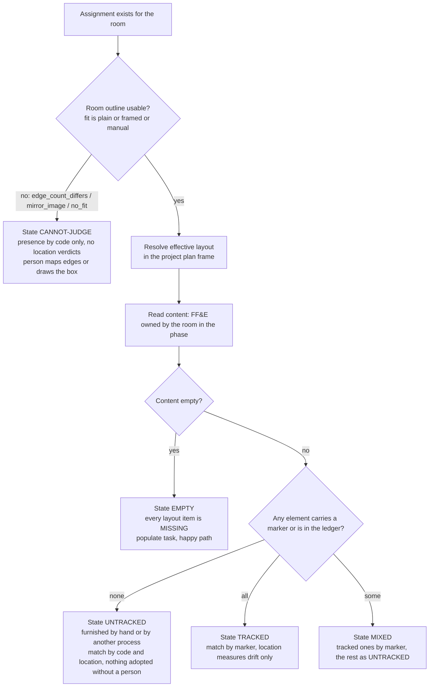
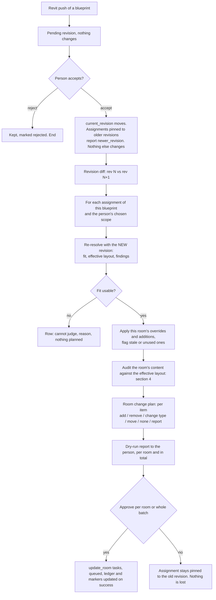

# Plan: what a room already holds, and what a blueprint change does to it

Status: **design, nothing built** (2026-11-22, branch `blueprint-data-flow`). It answers three questions the
blueprint stack (`PLAN-blueprints.md`) leaves open: which FF&E in a room belongs to the blueprint assigned to it,
what happens in every assigned room when the blueprint is pushed again, and where a room's own differences
(overrides) fit in. Symbols are named, never lines.

## 1. What exists today, and the gap

Verified in the code, not assumed:

| Fact | Where | Consequence |
|---|---|---|
| The resolver is **blueprint + room -> placements**. It never reads the FF&E already in the room. | `service::blueprint_resolve` | "What is in the room" is not a question any server code answers. |
| The only room-content check is a **boolean per phase**, made in Revit: has content, and the task does not overwrite -> abort. | `task_plan` (`room_has_content`), `apply_facts.room_items` | Empty vs not empty. No notion of "this one is mine". |
| `update_room` tasks exist on the server (modes `Items` / `Locations`, dry run) but are **the same resolved layout as populate**, with no comparison; the plug-in does not know the kind and aborts one. | `task_build::update_from_assignment`, `UpdateMode` | The diff step this plan describes is the missing half. |
| Plan decision 12 (a marker on each placed element: blueprint id, revision, item id) is **not built**: `apply_write` writes none. | `PLAN-blueprints.md` decision 12 | Nothing in Revit says which element a blueprint made. Without it, "belongs to the blueprint" can only be guessed from type and position. |
| Overrides are **per assignment, per blueprint item**: exclude, nudge (whole mm, project plan frame), turn (whole degrees). They cannot add an item, change a type, or change a count. | `assignments::ItemOverride` | The corner-guard-in-a-column case cannot be expressed. |
| An assignment **pins a revision** (items only) and reports `newer_revision`. | `assignments::Assignment`, `AssignmentRow` | Nothing re-resolves or diffs when the blueprint moves on. |
| An item is matched in another room by family, then type name, then instance properties (decision 5); tags match by **type code** only (decision 27, `tag_type_code`). | decisions 5, 27 | Two matching rules exist. This plan has to pick one for content. |
| **Shared nested families are instances Revit will not let anyone move, delete or retype on their own**; they follow the host. Every door, window and FF&E item carries `sub_components` (flat, every depth, each with `parent_id`, category, family, type) **whether or not the nested instance was pushed**; a pushed one is an item with `super_component_id` (`is_component`). Capture excludes them (decision 16) and a blueprint holds none. | `contract::SubComponent`, `room_m/utils/nesting.py`, `[ffe] nested_components` | The blueprint's unit of placement is the **host**, and what comes with it is the host's family definition. A comparison that treats a component as its own item would propose moves Revit refuses. |
| Blueprint item placement is plan-only (edge, along, off, facing); height lives in the instance properties (`Elevation from Level`, `Mounting Height`). | `blueprint_model::Placement` | A wall device at the wrong height is invisible to a plan comparison. |

## 2. Vocabulary

- **Layout**: the blueprint's items at the pinned revision, as the resolver places them in this room now.
- **Effective layout**: layout, minus items this room excludes, with this room's nudges and turns applied, plus
  this room's additions (section 5). **This, never the bare layout, is what a room's content is compared with.**
- **Content**: the FF&E **hosts** the server already attributes to the room in the phase (`/ffe`,
  `owner_rooms_qualified`). Nested components are not content in their own right: each is read as part of its
  host (section 4.3).
- **Host / component**: a host is a placeable element; a component is a shared nested instance inside it
  (`super_component_id`, any depth). A component can be *read* and *tagged* but never *acted on* alone.
- **Kit**: a host's component set as its family and type define it (`sub_components`: family + type per component,
  with depth). Two hosts of the same type have the same kit; a different type of the same family usually does not.
- **Ledger**: what a populate or update task placed, item id -> Revit element id, recorded when the plug-in reports
  (not built; section 7).

## 3. The room's state against its assigned blueprint



| State | Meaning | What the server may do alone | Needs a person |
|---|---|---|---|
| EMPTY | No content in the phase. | Offer populate. | Nothing. |
| UNTRACKED | Content, none provably the blueprint's. | Report the audit (section 4). | Adopt matches (writes markers), or leave. |
| TRACKED | Content placed by this blueprint, found by marker. | Report drift and what a new revision changes. | Approve the update task. |
| MIXED | Some of each (a person added items, or a populate was part-adopted). | As UNTRACKED for the unmarked part. | As above. |
| CANNOT-JUDGE | No usable fit, so no expected positions. | Presence by code only. | A mapping or box before location is judged. |

"No ffe" is EMPTY, "some ffe" is any of the other four. The distinction that matters to a person is whether the
server can **prove** an element is the blueprint's (marker or ledger) or can only **infer** it (code and place).

## 4. Which element belongs to the blueprint: the match

Two axes, judged separately because they fail separately. Code answers "is this the right thing", location answers
"is it in the right place".

### 4.1 The algorithm

1. **Candidates**: the room's content only (owner room, phase), **hosts only** (`is_component` false). An element
   another room owns is not a candidate even if it stands in this room's outline; that is the owner attribution's
   question. A component is never a candidate: it is looked at in step 7, through its host.
2. **Marker first.** An element whose marker names this blueprint and an item in the pinned revision is matched to
   that item by id. Code and location then only *measure* it (drift, wrong type). A marker naming a blueprint or
   item that no longer exists is reported (`marker_orphaned`), never matched by guesswork.
3. **Code second, for the unmarked.** Group the remaining elements and the remaining effective-layout items by key.
   **Key: type code** (the project's `tag_type_code` parameter, `PropertyTiers` instance-then-type, a blank
   instance value not shadowing a type value). Fallback to family + type name (decision 5) only for an item or element with **no code**, and
   the match is then labelled `by_name` so the person sees the weaker evidence. (Decision for the author: tags allow no
   fallback because a wrong tag is cosmetic; a wrong match here moves or deletes real elements, which argues for
   the fallback being a *report*, not a match, until the person confirms. See question 1.)
4. **Pair within a key by location**, in the project plan frame (the resolver's frame, so room rotation and the
   edge shift are already applied). Assign by smallest total distance (Hungarian, groups are small), not greedy
   nearest, so two same-code items swap correctly. Distance is centre to centre; facing is judged separately.
5. **Tolerance ladder**, settings with defaults, in mm and degrees:
   - `in_place`: distance <= `place_tol` (default 50 mm) and facing within `turn_tol` (5 degrees).
   - `moved`: distance <= `near_tol` (default 600 mm). Same thing, wrong place.
   - beyond `near_tol`: not a match. The element is `extra` and the item is `missing`; pairing them would
     call a different bed the same bed.
6. Height (wall devices): compare `Elevation from Level` / `Mounting Height` when both sides carry it, as a third
   verdict (`height_differs`) that never affects the plan match.
7. **Kit check, for every matched host** (section 4.3): compare the element's kit with the item's kit. A host that
   matches on code and place but whose kit differs is not `in_place`; it is `kit_differs`.

### 4.2 Verdicts

| Code | Location | Verdict | Meaning | Default action (update task) |
|---|---|---|---|---|
| matches an item | in tolerance | `in_place` | Right thing, right place. | none; adopt (write marker) |
| matches an item | within `near_tol` | `moved` | Right thing, wrong place. | `Locations` mode moves it; dry run lists it |
| matches an item | beyond | `extra` + `missing` | Same type elsewhere in the room, not this item. | report both |
| matches, more elements than items | any | `surplus` | Two guards where the layout has one. | report; never delete unmarked |
| in layout, nothing matches | n/a | `missing` | Layout item not in the room. | `Items` mode adds it |
| nothing in layout has this code | n/a | `foreign` | In the room, **not in code**: not the blueprint's. | **leave alone**, report |
| code differs, location within `place_tol` of an item | in tolerance | `substituted` | Something else stands where the item should (a different type of guard). | `Items` mode changes type only if the element is marked; else report |
| marked element, item gone from the pinned revision | n/a | `retired` | The blueprint no longer has it. | `Items` mode removes it if marked; else report |
| layout item, element deleted in Revit after placement (ledger has it, Revit does not) | n/a | `removed_by_hand` | A person took it out on purpose or by accident. | report; offer "make this an exclude override"; never silently re-add |
| matches on code and place | in tolerance | `in_place` **but kit differs** | Right host, different parts inside. | `kit_differs` reported; retyping the host is the only fix (section 4.3) |
| marked element, moved by hand since placement | n/a | `drifted` | Placed where the task said, now elsewhere. | report; offer "keep as a nudge override" or "reset to blueprint"; default is leave |

"Not in code" and "not in location" fall out of the table: **`foreign`** is not in code (no layout item shares its
code), **`extra`/`moved`** are right in code and wrong in location. Nothing the server cannot prove is deleted:
removal needs a marker or ledger entry, `foreign` and `surplus` unmarked elements are only ever reported.

### 4.3 Shared nested families: a host carries its kit, and every action on a host has knock-on effects

A component has no independent existence for this process. Everything is decided at the **host** and the
components are the consequences.

**What the audit reads.** For each matched host: the element's `sub_components` (always present, pushed or not) and,
when pushed, the component instances with their own properties. The blueprint item carries the same
`sub_components` as captured. The comparison is of **kits**, by family + type and depth, never by element id (ids
are per document and per placement).

**Why code is not enough.** The host's type code says the *type*. The kit is part of the *family definition*, so
the same code in a different family version, or the same family at a different type, can carry different parts.
Two hosts that agree on code and place can still differ in what they contain, and a person looking at the plan
cannot see it. Hence `kit_differs` as its own verdict.

| Verdict on a matched host | Meaning |
|---|---|
| `kit_same` | Same components by family + type and depth. Nothing to say. |
| `kit_differs` | A component in the blueprint's kit and not the element's (or reverse, or a different type of it). Reported with the list; the host is not `in_place` until it agrees. |
| `kit_unknown` | The element exported no `sub_components` (older snapshot) or the blueprint item has none. No evidence, never agreement (the `door_gap_mm` rule). |
| `component_edited` | A shared nested instance has a different instance property from the blueprint's (a nested handle in another finish). Reported; **the update cannot fix it directly** (see below). |

**The knock-on rule: a host action is the only action, and each one is stated with its effects.**

| Action on the host | Effect on its components | Therefore |
|---|---|---|
| Move or turn (`Locations`) | All components move with it, rigidly. | Safe. A component "in the wrong place" is a symptom of its host, never its own finding. |
| Change the host's type (`Items`, `substituted`, a blueprint type change) | The kit may **change**: components added, removed, retyped. Component instance parameters reset to the new type's. | The plan row says "kit changes: +2 -1"; tags and edits on the old components are lost. Warn, never silent. |
| Delete the host (`retired`) | Every component goes. | Counts as removing `N` elements; the plan lists them. |
| Add the host (`missing`) | The family brings its kit. | A family not loaded means the whole kit is missing (one warning at the host, as `family_available` does). |
| Edit a component's own property | Not possible without editing the host's nested parameters. | `component_edited` is **report-only** unless the property is exposed through the host (a shared parameter on it). Never promised as an update. |
| Tag a component | The tag follows the host's move. | Component tag rules (a rule exists for its type code) apply through the host; a retype that drops the component drops its tag candidate. |

**Consequences for the other sections.**

- **Override targets are hosts.** Exclude, nudge, turn and addition name a host item. There is no override on a
  component; offering one would be a promise Revit refuses. An exclude on a host excludes its kit.
- **A substitution override reports its kit effect** before it is saved (same table), because choosing another type
  is the one override with a hidden second effect.
- **Counting is of hosts.** A guard with a nested bracket is one guard. The audit reads components with
  `with_components` (as `rls_reads` does) whatever `[ffe] nested_components` says, and counts only hosts, so that
  setting must not change a verdict.
- **A component never gets its own marker or ledger row**; the host's covers it. A component whose host was
  deleted by hand is gone with it (`removed_by_hand` on the host).
- **A pushed component whose host is not in the room** (host in a linked model, or owned by another room) is not
  this room's content, however it is positioned. Ownership follows the host.
- **A component whose family is not loaded** is the host family missing, never a separate warning.

### 4.4 Requirements the match puts on the data

| Needed | Today | Work |
|---|---|---|
| Marker on every placed element: blueprint id, revision, item id, assignment id | not written | `apply_write` writes it (extensible storage on the element, or a shared parameter; **decision for the author**, it must survive copy/paste and export). The FF&E export carries it as a property. |
| Ledger: item id -> element id per task | not recorded | extend the task report; store with the task. A fallback when a marker was stripped. |
| Type code on both sides | on blueprint items as `properties`/`type_properties`; on content as the same tiers | name the parameter in the setting that already exists, or a second `item_code` setting if tag codes and content codes differ (question 2). |
| Content read in the project frame with footprint and facing | have (`insertion_point`, `facing`, `loops`) | none |
| Height | in properties only | compare as strings-to-number with the unit trap the ceiling offset taught (display strings). |
| **Kit on both sides**: blueprint item and content each carry `sub_components` | exported on every door/window/FF&E; `BlueprintItem` has **no** `sub_components` field | **new**: capture stores each item's kit (family, type, depth) beside its properties, so the audit compares kits. Without it, `kit_unknown` everywhere. A blueprint captured before has none until pushed again. |
| Host/component link for pushed components | `super_component_id` on the item, `parent_id` on a sub component | none; the audit groups components under hosts by it |
| Revit-side hosting (wall, face, level) | `host` read by `item_facts`, not run in Revit | wall-hosted items match by wall + along + height, not plan point alone. |

## 5. Overrides: one more kind, and one rule about where they hang

An override is **this room's difference from the blueprint**, applied to the layout before anything is judged
(already true for `exclude`, nudge and turn). The corner-guard case needs two more kinds.

| Kind | Example | Data | State |
|---|---|---|---|
| Exclude | no wardrobe in this room | `ItemOverride.exclude` | built |
| Nudge / turn (location) | bed 120 mm off the column | `dx_mm`, `dy_mm`, `rotate_deg` | built |
| **Addition** | blueprint has two corner guards; this room has a column corner and needs a third | `ItemAddition`: its own id (`add-<uuid>`), `clone_of: <item id>` or a full item, a recipe (`edge`, `along`, `off`, `facing`) in the room's coarse frame | **new** |
| **Substitution** | this room takes a different type of the same item | `type_name` / properties replacing the item's | new, optional, later |

Rules, each with its reason:

- **An addition is a room-local item, never written back to the blueprint.** The blueprint stays the standard; the
  room owns its exception. It joins the effective layout, is matched, marked and updated like any layout item.
- **An addition clones an item by reference** (`clone_of`), so when the blueprint changes the guard's type, the
  column-corner guard changes with it. A free-standing addition (no `clone_of`) keeps its own type. The person
  chooses; the default is clone, because "same guard, one more" is the common reason.
- **An addition anchors to the coarse outline's edge, and a column corner is a jog the coarse outline removed.**
  The same trap `CornerAnchored` already reports. The addition's recipe is therefore *edge + along + off*, set by
  the person on the plan, and judged against the fine outline for `outside`. It never needs the column to be an
  edge of its own.
- **An override is keyed to the item id and to the recipe it was made against** (`base`: a hash of the item's
  placement at that revision). On a new revision the override applies if `base` is unchanged and is flagged
  `override_stale` if the item's recipe moved (the nudge was a correction to a position that is gone).
  Today a nudge silently rides on whatever the new recipe gives; that is the failure to prevent.
- **A nudge is in the project plan frame** (as built). If the room's mapping changes (a different shift or a turn)
  the item rotates and the nudge does not. Either store nudges in the item's own frame (edge normal and tangent)
  or flag a nudge when the mapping changes. Recommendation: item frame, because a nudge "away from the wall"
  must stay "away from the wall" when the room is rotated.
- **Overrides survive a revision change; they are never dropped.** `override_unused` (item gone) and
  `override_stale` (recipe moved) are reported states the person resolves.

Example, three corner guards:

```text
Blueprint rev 3:  CG-1 (edge 2, along 0), CG-2 (edge 4, along 0)
Room 214:         column in the corner between edges 4 and 5
Override:         addition  add-9f2  clone_of CG-2  edge 5, along 0
Effective layout: CG-1, CG-2, add-9f2   -> 3 guards, one blueprint, one exception
Blueprint rev 4:  CG type changes to "CG-Steel-150"
Room 214 update:  all three change type; add-9f2 follows because it clones CG-2
```

## 6. Blueprint update: from a new push to every assigned room



### 6.1 The revision diff, and why it cannot rely on ids alone

A blueprint item's id is the Revit element id in the model it was captured from. A re-capture of the same room in
the same model keeps ids; a rebuilt room, a copied-to-new-model room, or a family replaced by delete-and-place
changes them. So the diff matches in two passes and says which it used:

1. By id (strong). 2. The unmatched remainder by the section 4.1 rules (type code, then nearest in the blueprint
room's own frame within `near_tol`), labelled `by_position`.

Classification of each item between revisions: `unchanged`, `moved` (recipe differs), `type_changed`,
`properties_changed`, `added`, `retired` (gone or newly excluded). The diff is stored with the revision (derived,
cached by the pair of revision numbers; nothing else is stored).

### 6.2 What happens in one room, by outcome

| Case | Room state | Outcome |
|---|---|---|
| Item unchanged | TRACKED | no action; marker revision advances |
| Item moved in the blueprint, no override | TRACKED | element moves; if it `drifted` by hand first, report and leave unless the person resets |
| Item moved, room has a nudge on it | TRACKED | `override_stale`: **applied to nothing until the person confirms** (keep nudge on the new recipe, or drop it) |
| Item type changed | TRACKED | `Items` mode changes type; `Locations` mode reports. **The row states the kit effect** (`+2 -1` components, tags on removed ones lost) |
| Item's kit changed, type code did not (a family reloaded with other parts) | TRACKED | `kit_differs`; host reloaded or retyped, never components edited; report-only unless the family can be reloaded |
| Item added in the blueprint | any | `missing`; added; in an UNTRACKED room, matched first so an existing equivalent is adopted, not duplicated |
| Item retired in the blueprint | TRACKED | marked element removed in `Items` mode; unmarked match reported only |
| Item retired, room has an addition cloned from it | TRACKED | `clone_of` dangling: addition is kept as a free-standing item and flagged; never deleted silently |
| Item excluded in this room | any | not in the effective layout; a marked element for it is `retired`, an unmarked one `foreign` |
| Room redrawn since assignment | any | re-resolved against today's outline; items that fall `outside` or `overlap` are findings on the plan, nothing blocks |
| Room's edge count now differs | CANNOT-JUDGE | no positions; person maps or boxes; presence report only |
| Room is now a mirror image | CANNOT-JUDGE | says so; the other hand is its own blueprint (decision 7) |
| Room moved or rotated in the model | any | follows (nothing positional is stored); elements that did not move with it show as `moved` |

**Rotation and slightly different shapes** are the resolver's job and stay there: the cyclic shift (door agreement
breaking ties) maps blueprint edges to room edges, recipes are read against the room's own edges (fixed mm, or
percentage along the anchored edge), and the audit compares in the project plan frame *after* that. The audit adds
no rotation logic of its own. Where the resolver cannot map the edges, the audit says so rather than inventing a
mapping. Different coarse edge count and the box (`Frame`) are the two escape hatches that exist today; the box
resolves recipes against a person-shaped rectangle, so an audit under a box measures against the box's positions.

## 7. Happy and unhappy paths

| # | Scenario | Happy path | Unhappy paths and their outcome | Needs |
|---|---|---|---|---|
| 1 | Assign to an empty room | resolve, populate task, marker + ledger written | phase missing, room gone: abort in the plug-in (existing checks); family missing: warning | marker, ledger |
| 2 | Assign to a room with matching furniture by hand | audit lists `in_place`/`moved`/`missing`; person adopts; markers written, no duplicates | wrong code (`substituted`), extra of same type (`surplus`), unrelated items (`foreign`): reported, nothing touched | audit read, adopt step |
| 3 | Assign to a room whose shape is off | best fit, findings on the few items that fall `outside` | `edge_count_differs`: no positions, person maps edges or draws the box; mirror: other-hand blueprint | existing fit kinds |
| 4 | Assign to a rotated room | cyclic shift maps edges, items turn with the room | two equally good shifts: doors break the tie; none: `doors_disagree` is reported, the person pins a shift | existing |
| 5 | Room needs one more guard (column) | addition cloned from CG-2 | addition's anchor outside the fine outline: `outside` finding | `ItemAddition` |
| 6 | Blueprint pushed again, accepted, room untouched | diff, re-resolve, plan shows the real changes only, approve, update task | a room whose content drifted: report, not overwrite | diff, audit, update kind in the plug-in |
| 7 | Blueprint update touches an item the room overrode | override applies if its base recipe is unchanged | recipe moved: `override_stale`, held for the person | `base` on overrides |
| 8 | Blueprint update retires an item | marked element removed; override or addition on it flagged | unmarked lookalike: reported only | marker |
| 9 | A person deleted a placed item in Revit | audit shows `removed_by_hand` | re-adding silently would undo a decision; person chooses: make it an exclude, or add again | ledger |
| 10 | A person moved a placed item by hand | audit shows `drifted` | update would pull it back: default leaves it, offer "keep as nudge" or "reset" | marker + footprint read |
| 11 | Plug-in cannot run the update kind | update stays queued | today: planner aborts the unknown kind | plug-in `update_room` handler |
| 12 | Revit session dies mid-task | task `in_progress` | resend (existing); markers make a re-run idempotent | marker |
| 13 | Host retyped by an update | host changes type, kit follows | components lost or added, tags on dropped ones lost: the plan row shows it before approval; component property edits are unrecoverable | `sub_components` on items |
| 14 | A component was tagged or edited by hand, update moves its host | tag and component move with the host | host retyped in the same update: the tag candidate may vanish | kit effect in the plan |
| 15 | Room holds a nested part whose host is another room's or a link's | not this room's content | would read as `foreign` if components were candidates; hosts-only candidacy prevents it | host ownership |

## 8. What gets built, in order (each step is useful alone)

1. **Audit read** (`service::blueprint_audit`, `GET .../assignments/{id}/audit`, one MCP read): effective layout vs
   content, verdicts of section 4.2, by code and location, no marker yet (everything is UNTRACKED), hosts only, kits compared from `sub_components`. Pure over data
   the server already holds. Settings: `place_tol`, `near_tol`, `turn_tol`. **This answers the first question and
   needs no Revit change**, so it is first.
1b. **Kit on a blueprint item** (`BlueprintItem.sub_components`, filled at capture; an older blueprint reads `kit_unknown`
   until pushed again) and the plan row's "kit changes" line.
2. **Overrides: additions, `base`, item-frame nudges** (`assignments`), the viewer's assign view gets "add one here",
   `override_stale` finding.
3. **Revision diff** (`service::blueprint_diff`, derived, cached by revision pair) and an **impact read** over all
   assignments of a blueprint: per room the change plan of section 6, dry run only.
4. **Marker and ledger**: `apply_write` writes the marker; the report returns the ledger; the FF&E export carries
   the marker; the audit switches TRACKED rooms to marker matching. **Needs a run in Revit.**
5. **`update_room` in the plug-in**: `Items` and `Locations` modes from the audit's plan, removal only for marked
   elements.
6. **Approve flow in the viewer**: the impact list per blueprint, per-room or batch approve, queues the tasks.

Steps 1 to 3 are server and viewer only and testable on House A (`samples/house-a/`: assignments, the blueprint
and a task already exist). 4 and 5 depend on Revit.

## 9. Questions for the author

1. **Match key for content with no type code:** fall back to family + type name as a *report* (recommended, since
   a wrong match moves or removes real elements), or as a match like decision 5?
2. **One code or two:** is the tag type-code parameter also the right identity for content, or does content need its
   own `item_code` setting?
3. **Marker storage:** extensible storage on the element (invisible, survives copy but needs the plug-in to read),
   or a shared parameter (visible and exportable, but a person can edit it)? Recommendation: extensible storage,
   plus the ledger as the fallback.
4. **Tolerances:** are 50 mm / 600 mm / 5 degrees the right starting values for furniture, and should wall devices
   (switches, rails) have their own, tighter plan tolerance and a height one?
5. **Removal policy in `Items` mode:** only marked elements removed (recommended), or never remove, only report?
6. **Scope of an update:** all assignments of the blueprint at once, or the person ticks rooms (the batch view
   already ticks rooms for assignment)? Recommendation: tick, with "all not overridden" as a quick choice.
7. **Kit mismatch policy:** is a host whose kit differs from the blueprint's (same type code) `in_place` with a
   warning, or never `in_place`? Recommendation: never, because the update cannot repair it without a retype or a
   family reload, and a person should decide.
8. **Component property edits:** is report-only acceptable for a change to a nested instance's own parameters,
   unless exposed on the host? The API gives no other way through.
