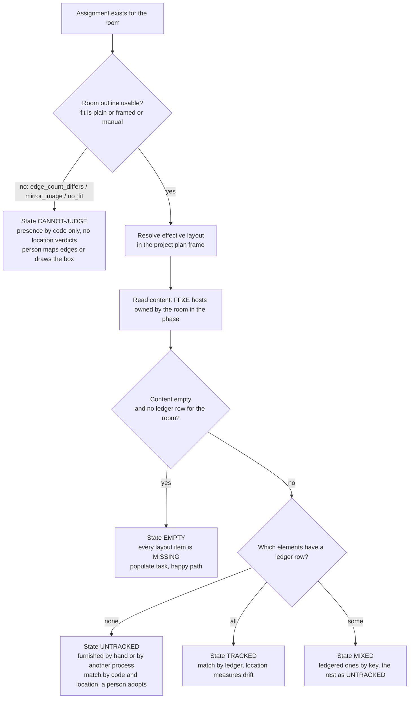
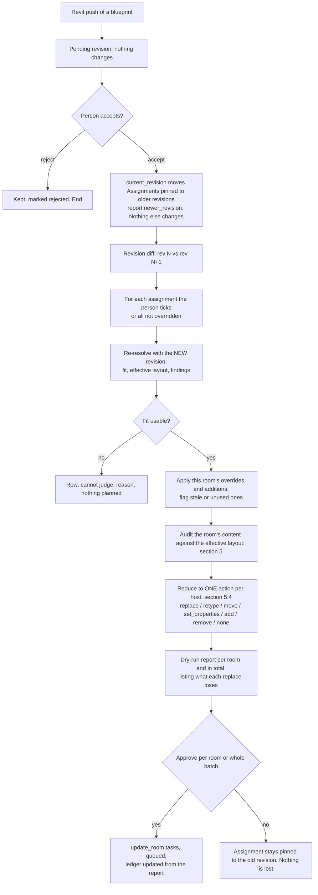

# Plan: what a room already holds, and what a blueprint change does to it

Status: **design, nothing built** (2026-11-23, branch `blueprint-data-flow`, into `blueprint-feature`). It answers three
questions the blueprint stack (`PLAN-blueprints.md`) leaves open: which FF&E in a room belongs to the blueprint assigned to
it, what happens in every assigned room when the blueprint is pushed again, and where a room's own differences (overrides)
fit in. Symbols are named, never lines.

**Decided by the author (2026-11-23):** identity is a **server-side ledger keyed by Revit `UniqueId`**, with no marker in the
Revit model; the type-code parameter is the content identity; tolerances are settings (5 mm place, 600 mm near, 5 degrees
turn); only elements the ledger proves are ours are ever removed; an update is chosen room by room with "all not overridden"
as a quick choice; a host whose kit differs is never `in_place`; **a nested family can only be changed through its host, and
a host action is decided once, as a whole** (section 5.4).

## 1. What exists today, and the gap

Verified in the code, not assumed:

| Fact | Where | Consequence |
|---|---|---|
| The resolver is **blueprint + room -> placements**. It never reads the FF&E already in the room. | `service::blueprint_resolve` | "What is in the room" is not a question any server code answers. |
| The only room-content check is a **boolean per phase**, made in Revit: has content, and the task does not overwrite -> abort. | `task_plan` (`room_has_content`), `apply_facts.room_items` | Empty vs not empty. No notion of "this one is mine". |
| `update_room` tasks exist on the server (modes `Items` / `Locations`, dry run) but are **the same resolved layout as populate**, with no comparison; the plug-in does not know the kind and aborts one. | `task_build::update_from_assignment`, `UpdateMode` | The diff step this plan describes is the missing half. |
| Nothing records **which Revit element a task placed**. Plan decision 12 (a marker on each placed element) was never built, and this plan replaces it with a server-side ledger (section 3). | `PLAN-blueprints.md` decision 12, `apply_write` | Today "belongs to the blueprint" could only be guessed from type and position. |
| The export carries the Revit `ElementId` as the item id (per document), and `IfcGUID` only as an instance property. **`UniqueId` is not exported.** | `contract::Opening::id`, `item_facts` | One field to add on the producer side (section 5.5). |
| Overrides are **per assignment, per blueprint item**: exclude, nudge (whole mm, project plan frame), turn (whole degrees). They cannot add an item, change a type, or change a count. | `assignments::ItemOverride` | The corner-guard-in-a-column case cannot be expressed. |
| An assignment **pins a revision** (items only) and reports `newer_revision`. | `assignments::Assignment`, `AssignmentRow` | Nothing re-resolves or diffs when the blueprint moves on. |
| An item is matched in another room by family, then type name, then instance properties (decision 5); tags match by **type code** only (decision 27, `tag_type_code`). | decisions 5, 27 | **Decided: the type code is the identity for content too.** |
| **Shared nested families are instances Revit will not let anyone move, delete or retype on their own**; they follow the host. Every door, window and FF&E item carries `sub_components` (flat, every depth, each with `parent_id`, category, family, type) **whether or not the nested instance was pushed**; a pushed one is an item with `super_component_id` (`is_component`). Capture excludes them (decision 16) and a blueprint holds none. | `contract::SubComponent`, `room_m/utils/nesting.py`, `[ffe] nested_components` | The unit of placement is the **host**; what comes with it is the host's family definition. |
| Blueprint item placement is plan-only (edge, along, off, facing); height lives in the instance properties (`Elevation from Level`, `Mounting Height`). | `blueprint_model::Placement` | A wall device at the wrong height is invisible to a plan comparison. |

## 2. Vocabulary

- **Layout**: the blueprint's items at the pinned revision, as the resolver places them in this room now.
- **Effective layout**: layout, minus items this room excludes, with this room's nudges and turns applied, plus this
  room's additions (section 6). **This, never the bare layout, is what a room's content is compared with.**
- **Content**: the FF&E **hosts** the server already attributes to the room in the phase (`/ffe`,
  `owner_rooms_qualified`). A nested component is read as part of its host (section 5.3), never as content of its own.
- **Host / component**: a host is a placeable element; a component is a shared nested instance inside it
  (`super_component_id`, any depth). A component can be *read* and *tagged* but never *acted on* alone.
- **Kit**: a host's component set as its family and type define it (`sub_components`: family + type per component, with depth).
- **Ledger**: the server's record of which element each task placed (section 3).
- **Type code**: the value of the one type parameter the project names (`tag_type_code`), read instance-then-type.

## 3. Provenance: the ledger, keyed by `UniqueId`

**Why a marker in Revit is the wrong tool.** A shared parameter can be edited, and any marker can be lost by a copy, a
reload or a person moving the item. It is also one more thing written into the model. Everything a marker would say is already
knowable from the server's own data, if it keeps one record at the moment of placing.

**Why code, family, type and element id are not enough alone.** Family, type and code describe a *type*: every identical item
in a room shares them, so they cannot tell two corner guards apart. The element id can, but is per document and changes when an
element is re-created. **`UniqueId`** is Revit's stable identity for an element instance (the GUID of the document episode it
was created in, plus the element id): it survives save, reopen, Save As, worksharing and upgrade, and changes only when the
element is re-created (delete and place again, copy and paste, copy into another document) -- which is exactly when it should
no longer count as "ours".

**The ledger.** When the plug-in finishes a populate or update task it already holds the elements it made. It reports, per
item, `{item_id, element_id, unique_id}` with the task. The server stores a ledger row per placed element:

```text
{ assignment, blueprint, revision, item_id,           // which item of which revision
  model_id, unique_id, element_id,                    // which Revit element
  task, placed_at,                                    // when and by what
  replaced_from?: unique_id,                          // set when a replace superseded an older element
  adopted?: true }                                    // linked by a person, not made by a task
```

Stored as its own authored file per assignment, **not inside the assignment** (an assignment is a request, never a result)
and not under `blueprints/` (whose listing reads every `*.json`). A replace writes a new row and keeps the old one as
history.

**The key is `(model_id, unique_id)`**, with `(model_id, element_id)` as the fallback for snapshots exported before the field
existed. Reading it back is the ordinary FF&E push: every later push contains the element, so the audit finds it by key, reads
its *current* type code, position and owner room, and nothing is written into Revit.

**What a person does in Revit, and what the audit says:**

| Person's action | What the next push shows | State of the ledger row |
|---|---|---|
| Nothing | element at the placed position | `in_place` |
| Moved it a little | same key, new position | `drifted` |
| Moved it to another room | same key, owner room differs | `moved_out`: reported, never touched |
| Changed its type | same key, code differs | `retyped_by_hand`: reported, not reverted unless the update says so |
| Deleted it | key absent from a snapshot **newer than `placed_at`** | `removed_by_hand` |
| Deleted it, snapshot not refreshed yet | key absent from a snapshot older than `placed_at` | `not_yet_seen`: no verdict until the next push |
| Copied it | the copy is a new key | the copy is an unproven element (`foreign` or an adoption candidate); the original is unaffected |
| Renamed the model (the model id is the document title) | every key under the old id is absent | `model_changed`: nothing is judged; the person confirms the new model and the rows are re-keyed |

**Adoption.** A room furnished by hand (UNTRACKED) is audited by code and location (section 5). When a person confirms a
match, the server writes a ledger row marked `adopted`. This is a record, not a Revit write, and it is the *only* way an
unproven element becomes removable (section 5.2).

## 4. The room's state against its assigned blueprint



| State | Meaning | What the server may do alone | Needs a person |
|---|---|---|---|
| EMPTY | No content in the phase. | Offer populate. | Nothing. |
| UNTRACKED | Content, none in the ledger. | Report the audit. | Adopt matches, or leave. |
| TRACKED | Content placed by this blueprint, found by `UniqueId`. | Report drift and what a new revision changes. | Approve the update task. |
| MIXED | Some of each (a person added items, or a room was part-adopted). | As UNTRACKED for the unledgered part. | As above. |
| CANNOT-JUDGE | No usable fit, so no expected positions. | Presence by code only. | A mapping or box before location is judged. |

"No ffe" is EMPTY, "some ffe" is any of the other four. What matters to a person is whether the server can **prove** an
element is the blueprint's (ledger) or can only **infer** it (code and place).

## 5. Which element belongs to the blueprint: the match

Two axes, judged separately because they fail separately. Code answers "is this the right thing", location answers "is it in
the right place".

### 5.1 The algorithm

1. **Candidates**: the room's content only (owner room, phase), **hosts only** (`is_component` false). An element another
   room owns is not a candidate even if it stands in this room's outline; that is the owner attribution's question. A
   component is looked at in step 7, through its host.
2. **Ledger first.** An element whose key is in this assignment's ledger is matched to its item by that row. Code and location
   then only *measure* it (drift, retyped). A row whose item is gone from the pinned revision is `retired`. A key owned by
   another assignment is reported, never matched by guesswork.
3. **Code second, for the rest.** Group the remaining elements and the remaining effective-layout items by **type code**
   (instance-then-type, a blank instance value not shadowing a type value). An element or item with **no code** is not
   matched; it is reported as `no_code`, with a family + type name suggestion the person may confirm (which adopts it).
   Tags allow no name fallback; neither does this, because a wrong match here moves or removes real elements.
4. **Pair within a code by location**, in the project plan frame (the resolver's frame, so rotation and the edge shift are
   already applied), by smallest total distance (Hungarian; groups are small), not greedy nearest, so two same-code items swap
   correctly. Distance is centre to centre; facing is judged separately.
5. **Tolerances are project settings** (`[blueprint_audit]` in `roommate-shared`, ts-rs, a control on the settings page, a
   default in `defaults.ts`; changeable by the user):

   | Setting | Default | Meaning |
   |---|---|---|
   | `place_tolerance_mm` | **5** | within this, `in_place` |
   | `near_tolerance_mm` | **600** | within this, `moved`; beyond, not a match |
   | `turn_tolerance_deg` | **5** | facing within this agrees |

   Beyond `near_tolerance_mm` the element is `extra` and the item `missing`: pairing them would call a different bed the
   same bed.
   *Risk written down:* 5 mm is tight for items Revit hosts for us (a wall-hosted item snaps to the wall within 450 mm, so it
   may sit a few mm from the recipe's point). Such an item reads `moved` or `drifted` on the first audit after placing. That is
   to be measured in Revit, then either loosened or the comparison for hosted items made along the host. Until then it is a
   reported difference, never an action taken without a person.
6. Height (wall devices): compare `Elevation from Level` / `Mounting Height` when both sides carry it, as a separate verdict
   (`height_differs`) that never affects the plan match.
7. **Kit check, for every matched host** (section 5.3). A host that matches on code and place but whose kit differs is never
   `in_place`; it is `kit_differs`.

### 5.2 Verdicts

| Code | Location | Verdict | Meaning | Default action (update task) |
|---|---|---|---|---|
| matches an item | within `place_tolerance_mm` | `in_place` | Right thing, right place. | none; offer adoption if unledgered |
| matches an item | within `near_tolerance_mm` | `moved` (unledgered) / `drifted` (ledgered) | Right thing, wrong place. | `Locations` mode moves it; ledgered drift: default leave, offer "keep as nudge" or "reset" |
| matches an item | beyond | `extra` + `missing` | Same type elsewhere in the room, not this item. | report both |
| matches, more elements than items | any | `surplus` | Two guards where the layout has one. | report; never delete an unledgered element |
| in layout, nothing matches | n/a | `missing` | Layout item not in the room. | `Items` mode adds it |
| nothing in layout has this code | n/a | `foreign` | In the room, **not in code**: not the blueprint's. | **leave alone**, report |
| code differs, location within `place_tolerance_mm` of an item | in tolerance | `substituted` | Something else stands where the item should. | `Items` mode retypes or replaces only if ledgered; else report |
| ledgered element, item gone from the pinned revision | n/a | `retired` | The blueprint no longer has it. | `Items` mode removes it |
| ledger row, element gone from a newer snapshot | n/a | `removed_by_hand` | A person took it out. | report; offer "make this an exclude override"; never silently re-add |
| ledger row, owner room differs | n/a | `moved_out` | A person moved it to another room. | report; never touched |
| matches on code and place | in tolerance | `kit_differs` (not `in_place`) | Right host, different parts inside. | host action by section 5.4 |

**`foreign` is not in code; `moved`/`extra` are right in code and wrong in location.** Nothing the server cannot prove is
deleted: **only ledgered elements are ever removed** (decided). `foreign` and `surplus` unledgered elements are only reported.

### 5.3 Shared nested families: a host carries its kit

A component has no independent existence for this process. Everything is decided at the **host** and the components are the
consequences. **A nested instance cannot be moved, deleted or edited in Revit on its own, so the update never tries.**

**What the audit reads.** For each matched host: the element's `sub_components` (always present, pushed or not) and, when
pushed, the component instances with their own properties. The blueprint item carries the same `sub_components` as captured.
Kits are compared by family + type and depth, never by element id.

**Why code is not enough.** The host's type code says the *type*; the kit is part of the *family definition*, so a family
reloaded with other parts, or a nested family changed inside, can leave two hosts agreeing on code and place and differing in
what they contain, which a person cannot see on the plan.

| Verdict on a matched host | Meaning |
|---|---|
| `kit_same` | Same components by family + type and depth. |
| `kit_differs` | A component in the blueprint's kit and not the element's (or reverse, or another type of it). Reported with the list. |
| `kit_unknown` | The element exported no `sub_components` (older snapshot) or the blueprint item has none. No evidence, never agreement (the `door_gap_mm` rule). |
| `component_edited` | A nested instance has an instance property different from the blueprint's. Reported; **it can only be fixed through its host**. |

**Detecting a change in a nested family means finding its host.** The finding is attributed to the host through
`super_component_id` / `parent_id` (any depth: the top host is acted on). From that point it is a *host finding*, and what it
means for the host is decided in section 5.4, because the likely cure is replacing the host.

**Consequences for the other sections.**

- **Override targets are hosts.** Exclude, nudge, turn and addition name a host item; there is no override on a component.
  An exclude on a host excludes its kit.
- **Counting is of hosts.** A guard with a nested bracket is one guard. The audit reads components with `with_components` (as
  `rls_reads` does) whatever `[ffe] nested_components` says, and counts only hosts, so that setting never changes a verdict.
- **A component has no ledger row**; its host's covers it. A component whose host was deleted is gone with it.
- **A pushed component whose host is not in the room** (host in a linked model, or another room's) is not this room's content.
- **A component whose family is not loaded** is the host family missing: one warning at the host.

### 5.4 One action per host, decided once

A change to a nested family, a host retype, a kit mismatch and a moved host can all arise on the same host in one update. They
are **not independent**: replacing a host creates a new element (new `UniqueId`, new kit, the new type's default parameters,
and the family's own placement), which **makes every other change recorded on the old element irrelevant or lost**. So the
plan is never a list of changes per item; it is **one action per host**, reduced from everything found on it.

**Ranking of host actions, strongest first:**

| Action | When | What the new state is |
|---|---|---|
| `replace` | the family differs from the layout's; or the kit differs / a nested family changed and the family cannot be repaired in place (**the likely outcome of any nested change**) | New element from the effective layout: position and facing from the recipe, nudge and turn applied, the layout's type and instance properties. New `UniqueId`. |
| `retype` | same family, another type, and the kit follows the type | Same element, new type. The kit changes with it. |
| `move` | position or facing outside tolerance | Same element, new position. Components move rigidly with it. |
| `set_properties` | host instance properties differ and are settable | Same element, parameters set. |
| `none` | in place | nothing |

**The reduction rule: the strongest action on a host wins and absorbs the rest.** A `replace` already puts the element where
the effective layout says, with the layout's properties, so a `move` or `set_properties` found on the same host is not run
separately. The plan lists the host once, as `replace`, with the absorbed findings shown under it for the person's information.

**What a replace loses, and must say before approval (never silent):**

- hand changes on the old element: drift (a position a person chose), `retyped_by_hand`, a hand-edited instance parameter, an
  edit to a nested instance (`component_edited`);
- tags on the old element **and on its nested components**, and dimensions or anything else attached to it;
- elements hosted on it (listed by their `Host` property where the export carries one);
- any other recorded change on that host in the same update, which is absorbed (above).

If the person wants a hand change to survive, the plan offers to record it first as an override (a drift becomes a nudge, a
hand retype becomes a substitution), so the layout reproduces it. Otherwise it is lost by design.

**Ledger on a replace:** a new row for the new element, `replaced_from` the old key, the old row kept as history. Without
this the next audit would read the old key as `removed_by_hand`.

**Where the decision is made.** The server plans the action it can prove (family differs, kit differs, position differs); the
plug-in decides at run time whether a same-family kit change is repaired by a reload or needs a replace (it alone knows what
the API allows). The plan states the action as `replace_or_reload` where the server cannot tell, and the task result reports
what was done.

### 5.5 Requirements the match puts on the data

| Needed | Today | Work |
|---|---|---|
| **Ledger**: `{item, element_id, unique_id, model_id, task, placed_at, replaced_from?, adopted?}` per placed element | not recorded | extend the task report (`room_m/post_tasks.py`, `apply_write`) to return the ids it made; new store beside the assignments; adoption writes a row with `adopted` |
| **`unique_id` on every FF&E item** | not exported | the extractor reads `element.UniqueId` in `item_facts` (the producer, **not** duHast, as for `family_name` and `host`); contract field on the item; absent on old snapshots, which fall back to `element_id` and say so. **Needs a run in Revit.** |
| Type code on both sides | on blueprint items as `properties`/`type_properties`; on content the same tiers | none new: the existing `tag_type_code` setting is the identity (decided). An item with no code is `no_code`. |
| Content read in the project frame with footprint and facing | have (`insertion_point`, `facing`, `loops`) | none |
| Height | in properties only | compare as number with the unit trap the ceiling offset taught (display strings). |
| **Kit on both sides**: blueprint item and content each carry `sub_components` | exported on every door/window/FF&E; `BlueprintItem` has **no** `sub_components` field | **new**: capture stores each item's kit beside its properties. Without it, `kit_unknown` everywhere; a blueprint captured before has none until pushed again. |
| Host/component link for pushed components | `super_component_id` on the item, `parent_id` on a sub component | none; the audit groups components under hosts by it |
| Dependants of a host (hosted items, tags) | `host` read by `item_facts`, not run in Revit; tags exported for plan and elevation views only | list what the export knows; say so where it cannot |
| Tolerances | none | the three settings of section 5.1 |

## 6. Overrides: one more kind, and one rule about where they hang

An override is **this room's difference from the blueprint**, applied to the layout before anything is judged (already true
for `exclude`, nudge and turn). The corner-guard case needs two more kinds.

| Kind | Example | Data | State |
|---|---|---|---|
| Exclude | no wardrobe in this room | `ItemOverride.exclude` | built |
| Nudge / turn (location) | bed 120 mm off the column | `dx_mm`, `dy_mm`, `rotate_deg` | built |
| **Addition** | blueprint has two corner guards; this room has a column corner and needs a third | `ItemAddition`: its own id (`add-<uuid>`), `clone_of: <item id>` or a full item, a recipe (`edge`, `along`, `off`, `facing`) in the room's coarse frame | **new** |
| **Substitution** | this room takes another type of the same item | `type_name` / properties replacing the item's; **reports its kit effect before it is saved** (section 5.3) | new, optional, later |

Rules, each with its reason:

- **Every override names a host**, never a nested component (section 5.3). An exclude on a host excludes its kit.
- **An addition is a room-local item, never written back to the blueprint.** The blueprint stays the standard; the room owns
  its exception. It joins the effective layout, is matched, ledgered and updated like any layout item.
- **An addition clones an item by reference** (`clone_of`), so when the blueprint changes the guard's type, the column-corner
  guard changes with it. A free-standing addition keeps its own type. The default is clone, because "same guard, one more" is
  the common reason.
- **An addition anchors to the coarse outline's edge, and a column corner is a jog the coarse outline removed** (the trap
  `CornerAnchored` already reports). Its recipe is *edge + along + off*, set by the person on the plan, judged against the fine
  outline for `outside`. It never needs the column to be an edge of its own.
- **An override is keyed to the item id and to the recipe it was made against** (`base`: a hash of the item's placement at that
  revision). On a new revision it applies if `base` is unchanged and is flagged `override_stale` if the item's recipe moved.
  Today a nudge silently rides on whatever the new recipe gives; that is the failure to prevent.
- **A nudge is in the project plan frame** (as built). If the room's mapping changes the item rotates and the nudge does not.
  Store nudges in the item's own frame (edge normal and tangent): "away from the wall" must stay "away from the wall" when the
  room is rotated.
- **Overrides survive a revision change; they are never dropped.** `override_unused` (item gone) and `override_stale` (recipe
  moved) are reported states the person resolves.
- **An override survives a replace** (section 5.4): the replacement is built from the effective layout, which includes it.

Example, three corner guards:

```text
Blueprint rev 3:  CG-1 (edge 2, along 0), CG-2 (edge 4, along 0)
Room 214:         column in the corner between edges 4 and 5
Override:         addition  add-9f2  clone_of CG-2  edge 5, along 0
Effective layout: CG-1, CG-2, add-9f2   -> 3 guards, one blueprint, one exception
Blueprint rev 4:  CG type changes to "CG-Steel-150"
Room 214 update:  all three change type (or are replaced, if the family differs); add-9f2 follows because it clones CG-2
```

## 7. Blueprint update: from a new push to every assigned room



### 7.1 The revision diff, and why it cannot rely on ids alone

A blueprint item's id is the Revit element id in the model it was captured from. A re-capture of the same room in the same
model keeps ids; a rebuilt room, a copied-to-new-model room, or a family replaced by delete-and-place changes them. So the diff
matches in two passes and says which it used:

1. By id (strong). 2. The unmatched remainder by the section 5.1 rules (type code, then nearest in the blueprint room's own
frame within `near_tolerance_mm`), labelled `by_position`.

Classification of each item between revisions: `unchanged`, `moved` (recipe differs), `type_changed`, `kit_changed`,
`properties_changed`, `added`, `retired` (gone or newly excluded). The diff is derived and cached by the pair of revision
numbers; nothing else is stored.

### 7.2 What happens in one room, by outcome

| Case | Room state | Outcome |
|---|---|---|
| Item unchanged | TRACKED | no action; the ledger row's revision advances |
| Item moved in the blueprint, no override | TRACKED | `move`; if it had `drifted` by hand first, listed and left unless the person resets |
| Item moved, room has a nudge on it | TRACKED | `override_stale`: **held until the person confirms** (keep the nudge on the new recipe, or drop it) |
| Item type changed | TRACKED | `retype` or `replace` by section 5.4; `Locations` mode reports it |
| Nested family changed, or kit changed, type code did not | TRACKED | host finding -> usually `replace_or_reload`; absorbs any move on that host; lists what is lost |
| Item added in the blueprint | any | `missing`; added; in an UNTRACKED room matched first, so an existing equivalent is adopted, not duplicated |
| Item retired in the blueprint | TRACKED | ledgered element removed in `Items` mode; unledgered match reported only |
| Item retired, room has an addition cloned from it | TRACKED | `clone_of` dangling: addition kept as a free-standing item and flagged; never deleted silently |
| Item excluded in this room | any | not in the effective layout; a ledgered element for it is `retired`, an unledgered one `foreign` |
| Room redrawn since assignment | any | re-resolved against today's outline; items that fall `outside` or `overlap` are findings, nothing blocks |
| Room's edge count now differs | CANNOT-JUDGE | no positions; person maps or boxes; presence report only |
| Room is now a mirror image | CANNOT-JUDGE | says so; the other hand is its own blueprint (decision 7) |
| Room moved or rotated in the model | any | follows (nothing positional is stored); elements that did not move with it show as `moved` |

**Rotation and slightly different shapes** are the resolver's job and stay there: the cyclic shift (door agreement breaking
ties) maps blueprint edges to room edges, recipes are read against the room's own edges (fixed mm, or percentage along the
anchored edge), and the audit compares in the project plan frame *after* that. The audit adds no rotation logic. Where the
resolver cannot map the edges, the audit says so rather than inventing a mapping. Different coarse edge count and the box
(`Frame`) are the two escape hatches that exist today; under a box the audit measures against the box's positions.

## 8. Happy and unhappy paths

| # | Scenario | Happy path | Unhappy paths and their outcome | Needs |
|---|---|---|---|---|
| 1 | Assign to an empty room | resolve, populate task, ledger written from the report | phase missing, room gone: abort in the plug-in (existing checks); family missing: warning | ledger |
| 2 | Assign to a room with matching furniture by hand | audit lists `in_place`/`moved`/`missing`; person adopts; ledger rows `adopted`, no duplicates | wrong code (`substituted`), extra of the same type (`surplus`), unrelated items (`foreign`), no code (`no_code`): reported, nothing touched | audit read, adopt step |
| 3 | Assign to a room whose shape is off | best fit, findings on the few items that fall `outside` | `edge_count_differs`: no positions, person maps edges or draws the box; mirror: other-hand blueprint | existing fit kinds |
| 4 | Assign to a rotated room | cyclic shift maps edges, items turn with the room | two equally good shifts: doors break the tie; none: `doors_disagree` reported, the person pins a shift | existing |
| 5 | Room needs one more guard (column) | addition cloned from CG-2 | anchor outside the fine outline: `outside` finding | `ItemAddition` |
| 6 | Blueprint pushed again, accepted, room untouched | diff, re-resolve, plan shows the real changes, approve, update task | content drifted: report, not overwrite | diff, audit, plug-in update kind |
| 7 | Update touches an item the room overrode | override applies if its base recipe is unchanged | recipe moved: `override_stale`, held for the person | `base` on overrides |
| 8 | Update retires an item | ledgered element removed; override or addition on it flagged | unledgered lookalike: reported only | ledger |
| 9 | A person deleted a placed item in Revit | audit shows `removed_by_hand` | re-adding silently would undo a decision; person chooses: make it an exclude, or add again | ledger, snapshot newer than `placed_at` |
| 10 | A person moved a placed item by hand | audit shows `drifted` | update would pull it back: default leaves it, offer "keep as nudge" or "reset" | ledger + footprint read |
| 11 | A person moved a placed item to another room | audit shows `moved_out` | never touched, never re-added in this room until the person decides | owner room per push |
| 12 | Plug-in cannot run the update kind | update stays queued | today: planner aborts the unknown kind | plug-in `update_room` handler |
| 13 | Revit session dies mid-task | task `in_progress` | resend (existing); a re-run finds placed elements by ledger and does not duplicate | ledger |
| 14 | A nested family changed in the model | host finding, `replace_or_reload` | the replace absorbs a move and a retype on the same host and loses hand edits, tags and dependants: listed before approval; new `UniqueId` recorded with `replaced_from` | section 5.4, ledger |
| 15 | A nested part was edited by hand, update moves its host | the part moves with the host | the same host also needs a replace: the edit is lost unless the person recorded it as an override first | section 5.4 |
| 16 | Room holds a nested part whose host is another room's or a link's | not this room's content | would read as `foreign` if components were candidates; hosts-only candidacy prevents it | host ownership |
| 17 | The model was renamed | nothing is judged | `model_changed`; the person confirms the new model and the ledger is re-keyed | ledger |
| 18 | The snapshot is older than the placement | `not_yet_seen` | no `removed_by_hand` verdict until the next push | `placed_at` vs `taken_at` |

## 9. What gets built, in order (each step is useful alone)

1. **Audit read** (`service::blueprint_audit`, `GET .../assignments/{id}/audit`, one MCP read): effective layout vs content,
   verdicts of section 5.2 by code and location, hosts only. Everything is UNTRACKED until a ledger exists. Settings
   `[blueprint_audit]`. Pure over data the server holds. **Answers the first question with no Revit change**, so it is first.
   1b. **Kit on a blueprint item** (`BlueprintItem.sub_components`, filled at capture; an older blueprint reads `kit_unknown`
   until pushed again).
2. **Overrides: additions, `base`, item-frame nudges** (`assignments`), the viewer's assign view gets "add one here",
   `override_stale`.
3. **Revision diff** (`service::blueprint_diff`, derived, cached by revision pair) and an **impact read** over the assignments
   of a blueprint: per room the host-action plan of section 5.4, dry run only.
4. **Ledger and `UniqueId`**: the extractor exports `unique_id`; the task report returns the placed ids; the ledger store and
   adoption; the audit switches ledgered rooms to key matching. **Needs a run in Revit.**
5. **`update_room` in the plug-in**: `Items` and `Locations` from the plan, removal only for ledgered elements, `replace` and
   `replace_or_reload` for hosts.
6. **Approve flow in the viewer**: the impact list per blueprint, per-room tick with "all not overridden", queues the tasks.

Steps 1 to 3 are server and viewer only and testable on House A (`samples/house-a/`: assignments, the blueprint and a task
already exist). 4 and 5 depend on Revit.

## 10. Decisions and what is still open

Decided (2026-11-23): identity by ledger and `UniqueId`, no Revit marker; type code is the content identity; tolerances 5 mm /
600 mm / 5 degrees as user settings; remove only ledgered elements; update scope is ticked rooms with "all not overridden"; a
kit mismatch is never `in_place`; nested families are acted on only through their host, and a host's action is one reduced
action (section 5.4).

Still open:

1. **No-code items:** the plan reports them with a name suggestion the person can confirm (adopt). Not yet confirmed by the
   author; say if a name match should be automatic.
2. **Wall devices:** switches and rails may need a tighter plan tolerance and a height tolerance of their own; wait for the
   first Revit run (section 5.1 risk) before adding settings.
3. **How a same-family kit change is repaired** (reload the family, or replace the host): the plug-in decides at run time
   (section 5.4); the first Revit run will show which the API allows.
